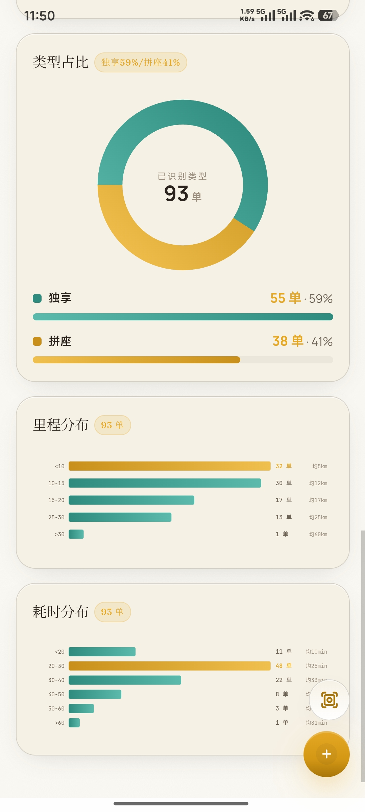
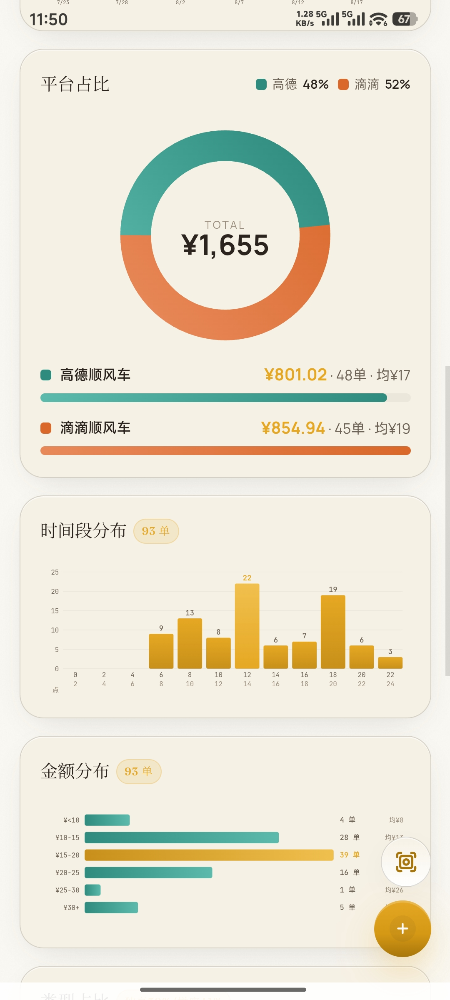
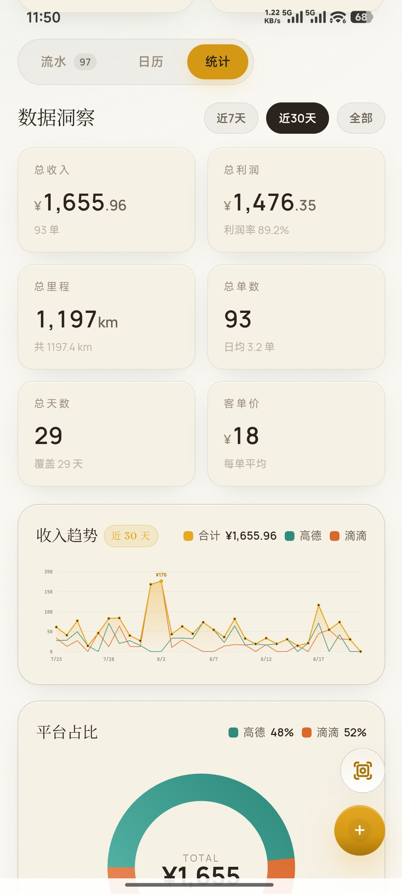
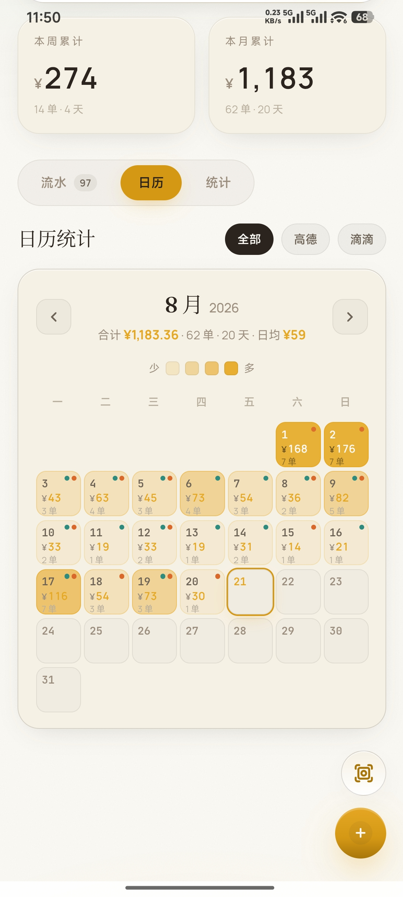
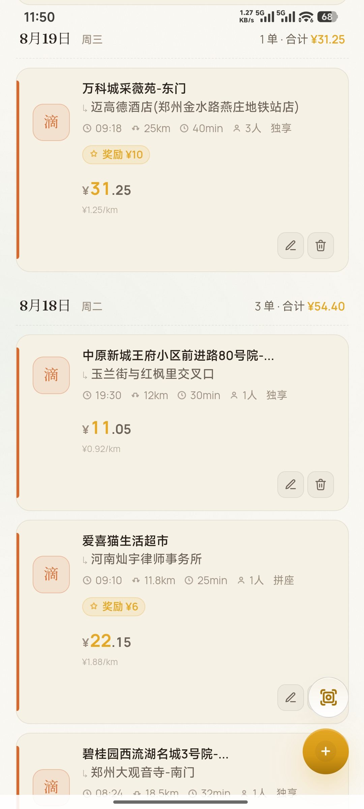
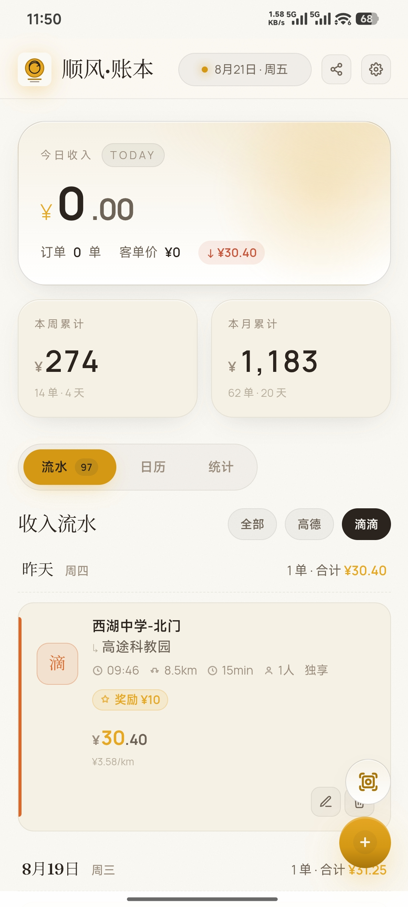

<div align="center">

# 🚗 顺风·账本

一个面向顺风车司机的收支记账 Android 应用，支持 **拍照识别订单 → 一键入账 → 数据统计** 的完整闭环。


[](https://kotlinlang.org)
[](https://developer.android.com/build/releases/gradle-plugin)
[](https://github.com/YOUR_ORG/shunfeng-ledger/releases)

*纯本地记账 · 数据不落服务器 · 支持桌面小组件*

</div>

---

## 📌 项目简介

「顺风·账本」是一款为网约车 / 顺风车司机打造的轻量记账工具。司机每天会接到大量平台订单（滴滴、高德等），逐笔手动登记耗时费力。本应用通过 **智能大模型识别订单截图**，自动提取车费、时间、起终点、人数、拼座 / 独享等信息并一键入账，同时提供 **里程 / 耗时估算** 与丰富的 **经营数据统计**。

应用采用 **原生 Android + WebView(H5) 混合架构**，原生侧负责 OCR 文本识别与桌面小组件，H5 侧负责业务逻辑与界面交互。

- ✅ **纯本地存储**：全部数据保存在设备 `localStorage`，不上传任何服务器。
- ✅ **AI 驱动录入**：拍照 / 截图即可自动识别订单，无需手动填写。
- ✅ **经营统计**：收入、利润、客单价、里程、时长等多维度可视化。

## ✨ 功能特性

| 模块 | 说明 |
|------|------|
| 📷 **智能识别** | 识别订单截图，自动提取时间、起终点、人数、车费、拼座/独享、奖励车费等 |
| 🧭 **里程估算** | 识路大模型根据起终点与时间计算开车里程、开车耗时（高峰自动标注） |
| ⚡ **一键入账** | 识别结果需经一次确认即可入账，支持手动增改删 |
| 👤 **首页看板** | 今日订单、今日收入、起终点、类型（拼座/独享）、人数分层展示 |
| 📊 **数据统计** | 总收入、总利润、客单价、总里程、总单数、总天数；独享/拼座占比、里程与耗时分布 |
| 🗓️ **日历视图** | 按日查看历史订单与每日明细 |
| 🖥️ **桌面小组件** | 无解锁即可查看今日收入、单数与最近订单列表 |
| 🧩 **灵活配置** | 识图 / 识路两个大模型独立配置，提示词可直接查看与修改 |
| 🔌 **连接测试** | 设置页内一键测试模型连通性 |

## 📱 应用截图

<p align="center">
  &nbsp;
  &nbsp;
  
</p>
<p align="center">
  <sub>首页看板&nbsp;&nbsp;&nbsp;&nbsp;&nbsp;&nbsp;&nbsp;&nbsp;&nbsp;&nbsp;&nbsp;&nbsp;&nbsp;&nbsp;&nbsp;&nbsp;&nbsp;&nbsp;&nbsp;&nbsp;&nbsp;&nbsp;&nbsp;&nbsp;订单列表&nbsp;&nbsp;&nbsp;&nbsp;&nbsp;&nbsp;&nbsp;&nbsp;&nbsp;&nbsp;&nbsp;&nbsp;&nbsp;&nbsp;&nbsp;&nbsp;&nbsp;&nbsp;&nbsp;&nbsp;&nbsp;&nbsp;&nbsp;&nbsp;智能识别</sub>
</p>

<p align="center">
  &nbsp;
  &nbsp;
  
</p>
<p align="center">
  <sub>数据统计&nbsp;&nbsp;&nbsp;&nbsp;&nbsp;&nbsp;&nbsp;&nbsp;&nbsp;&nbsp;&nbsp;&nbsp;&nbsp;&nbsp;&nbsp;&nbsp;&nbsp;&nbsp;&nbsp;&nbsp;&nbsp;&nbsp;&nbsp;&nbsp;日历视图&nbsp;&nbsp;&nbsp;&nbsp;&nbsp;&nbsp;&nbsp;&nbsp;&nbsp;&nbsp;&nbsp;&nbsp;&nbsp;&nbsp;&nbsp;&nbsp;&nbsp;&nbsp;&nbsp;&nbsp;&nbsp;&nbsp;设置与模型</sub>
</p>

## 🛠️ 技术栈

- **语言**：Kotlin 1.9.24 / JavaScript (ES6+)
- **架构**：原生 Android + WebView 混合开发
- **UI**：自定义 H5 界面（暖纸主题）+ 原生布局（小组件 / 启动页）
- **OCR**：原生 Tesseract（[Tesseract4Android](https://github.com/adaptech-cz/Tesseract4Android)）+ 前端 [Tesseract.js](https://github.com/naptha/tesseract.js)
- **大模型**：识图 / 识路两个可配置的 LLM 接口（OpenAI 兼容协议）
- **小组件**：Android AppWidget（`RemoteViews` + `SharedPreferences` 数据桥）
- **网络**：INTERNET / ACCESS_NETWORK_STATE

## 📦 安装

### APK 安装（推荐）

1. 前往 **Releases** 页面下载最新的 `app-release.apk`。
2. 将 APK 传输到手机（或扫码下载）。
3. 点击安装，允许「安装未知来源应用」。
4. 打开「顺风·账本」，进入 **设置** 配置识图 / 识路大模型后即可使用。

> 最低支持 Android 6.0（API 23）。

### 从源码构建

```bash
# 1. 克隆仓库
git clone https://github.com/YOUR_ORG/shunfeng-ledger.git
cd shunfeng-ledger

# 2. 配置签名（可选，仅发布 release 需要）
#    将签名文件放在 app/release.jks，并设置环境变量：
export SHUNFENG_STORE_PASSWORD=your_store_password
export SHUNFENG_KEY_PASSWORD=your_key_password

# 3. 构建（debug 免签名）
./gradlew assembleDebug

#    或构建 release（需签名配置）
./gradlew assembleRelease
```

构建产物位于 `app/build/outputs/apk/`。

## 🚀 使用方法

### 1. 配置大模型（首次必做）

进入 **设置 → 识别引擎**：

- **识图大模型**：用于解析订单截图，推荐智谱视觉模型（如 `glm-4.5v`）。
- **识路大模型**：用于估算里程与耗时，推荐 `deepseek-chat` 等文本模型。
- 分别填入 `Endpoint`、`Model`、`API Key`，可点击 **🔌 连接测试** 验证连通性。
- 预设提示词已默认填入，可随时查看与修改。

### 2. 录入订单

1. 首页点击「识别订单」。
2. 选择或拍摄一张订单截图。
3. 大模型自动识别出订单信息，**确认一次**即可入账。
4. 认（多次）到账的订单可在订单列表中查看或修改。

### 3. 查看统计

进入「统计」页查看：
- 总收入、总利润、客单价、总里程、总单数、总天数。
- 独享 / 拼座比例、里程分布、耗时分布图表。

### 4. 桌面小组件

在桌面长按 → 添加「顺风·账本」小组件，即可实时查看今日数据。

## 🤝 贡献指南

欢迎提交 PR 与 Issue！

1. **Fork** 本仓库并创建你的分支。
2. 遵循现有代码风格（Kotlin 官方风格、前端 ES6）。
3. 修改后请自测，确保持模块不影响其余功能。
4. 提交时**严禁包含 API Key、签名文件 `*.jks` 或任何敏感数据**。
5. 通过 Pull Request 提交，并附带清晰的改动说明。

开发环境要求：Android Studio Ladybug+ / JDK 17 / Android SDK 34。

## 📄 目录结构

```
shunfeng-ledger/
├── app/
│   ├── build.gradle.kts           # 模块构建脚本（含签名配置）
│   └── src/main/
│       ├── AndroidManifest.xml    # 组件与权限声明
│       ├── assets/                # H5 前端 & OCR 训练数据
│       │   ├── index.html         # 主界面（业务逻辑）
│       │   └── tessdata/          # Tesseract 语言数据
│       ├── java/com/shunfeng/ledger/
│       │   ├── MainActivity.kt    # 主入口 & WebView 桥接
│       │   ├── OcrEngine.kt       # 原生 Tesseract OCR
│       │   └── TodayWidgetProvider.kt  # 桌面小组件
│       └── res/                   # 布局 / 资源 / 主题
├── docs/screenshots/              # README 中展示的应用截图
├── build.gradle.kts               # 根构建脚本
├── settings.gradle.kts            # 工程配置
├── gradle.properties              # Gradle 全局配置
├── gradlew / gradlew.bat           # Gradle Wrapper
├── README.md                      # 项目说明文档
└── .github/workflows/android-ci.yml # CI 自动构建
```

## 🔒 安全说明

- **API Key**：请写在应用内设置页并保存在设备本地，**切勿提交到仓库**。
- **签名密钥**：签名文件与密码通过环境变量注入，仓库中不存在真实密钥。
- **数据隐私**：所有订单数据仅保存在设备本地，应用不采集、不上传任何用户数据。

## 📄 许可证

本项目当前未发布正式开源许可证，保留所有权利。如需使用或二次开发请联系作者。

---

<div align="center">Made with 💛 for independent drivers</div>